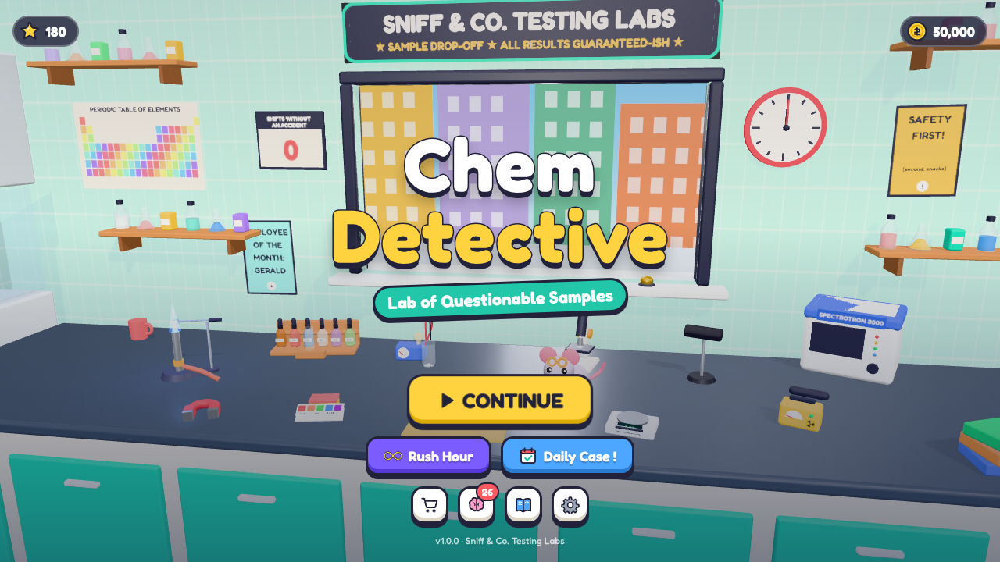

# Chem Detective — *Lab of Questionable Samples*

A funny, polished **3D browser game** about working at *Sniff & Co. Testing Labs*. Grannies, gym bros, cops, food
inspectors, factory foremen, environmental agents, astronauts, an alien and a mad scientist bring you mystery samples.
You sniff, burn, drip, zap and scan them with real chemistry tests, cross off suspects, and file your report before the
shift clock runs out — while Gerald the lab rat comments on everything.

Built for web game portals (Poki, CrazyGames, GameDistribution, AdSense-for-games, self-hosting) with ad hooks,
mobile + desktop controls, and a long progression loop designed for long sessions and repeat visits.



---

## Highlights

| | |
|---|---|
| **60 hand-designed levels** | 6 chapters (Kitchen Chaos → Police Precinct → Food & Drug Authority → Industrial Mayhem → Environmental Agency → Top Secret Lab), a boss shift ending every chapter |
| **163 substances** | Real chemistry: pH, flame colours, smells, precipitates, UV glow, density, molecular mass, radioactivity… plus a few top-secret fictional ones. Every one has a fun fact for the **Chem Dex** collection |
| **17 lab instruments** | pH strip, sniff test, Bunsen flame test, microscope, 6 reagent drops, conductivity probe, magnet, UV lamp, density scale, splint test, Geiger counter, mass spectrometer |
| **7 skill mini-games** | Timing bar, hold-and-release, reagent drops, sniff rhythm, microscope focus, UV sweep, background machines |
| **31 characters, 89 case scenarios** | Each with funny request / success / failure lines and a babbling voice |
| **Deep progression** | 18 equipment upgrades (pro & automatic tiers), 8 lab perks, 4 consumables, 12 cosmetics (Gerald hats + lab themes), 9 skills, 18 ranks |
| **Replay modes** | 3 stars per level (Clear / Flawless / Speedy), **Rush Hour** endless mode, **Daily Case**, 7-day **daily bonus** |
| **25 achievements** | Funny long-term goals ("Eyebrows Optional", "Human Pipette", "Element Whisperer"…) that pay out coins and bonus skill points |
| **Risk/reward** | *Bold Call* — identify early with several suspects left for a bigger payout |
| **Ads built in** | Rewarded ads (double coins, continue after failing, free items, free coins, double daily bonus) + interstitials between shifts, behind one adapter layer |
| **Tiny & fast** | ~1.1 MB total download, all 3D models / art / music / sound effects are generated in code — no asset licences to worry about |
| **Works everywhere** | Desktop (mouse + keyboard shortcuts) and mobile (touch, portrait & landscape), auto quality scaling, safe in iframes |

## Quick start

```bash
npm install          # Node 18+ (tested on Node 22)
npm run dev          # http://localhost:5173 — dev build with simulated test ads
npm test             # data validation: every one of the 60 levels is proven solvable
npm run release      # builds every portal version → release/*.zip  (+ the single-file .html)
npm run build:single # just the single-file edition → release/chem-detective-v1.0.0.html
```

**Just want to play?** Open `release/chem-detective-v1.0.0.html` in any modern browser (Chrome, Edge, Firefox, Safari).
That one file *is* the complete game — all 60 levels, 3D lab, music, fonts and saves — no server, no install, no internet needed.
Progress is saved in the browser, so it is kept between sessions as long as you open the file from the same place in the same browser.

Dev-only URL helpers (they are stripped from production builds):
`?level=25` jump straight into a level · `?unlockall` unlock everything · `?coins=5000` · `?fresh` wipe the save.
`?lowgfx=1` (start in low graphics, no anti-aliasing) also works in every build.

## Publishing

`npm run release` produces one upload-ready zip per platform in `release/`:

| Zip | Use it for | Ads |
|---|---|---|
| `chem-detective-poki-*.zip` | [Poki for Developers](https://developers.poki.com) | Poki SDK v2 (`commercialBreak`, `rewardedBreak`, `gameplayStart/Stop`, `gameLoadingFinished`) |
| `chem-detective-crazygames-*.zip` | [CrazyGames Developer Portal](https://developer.crazygames.com) | CrazyGames SDK v3 (midgame + rewarded ads, `gameplayStart/Stop`, `loadingStart/Stop`, `happytime`, cloud save via `SDK.data`) |
| `chem-detective-gamedistribution-*.zip` | [GameDistribution](https://gamedistribution.com) (also syndicates to hundreds of sites) | GD HTML5 SDK (interstitial + rewarded) |
| `chem-detective-adsense-*.zip` | Your own website | Google AdSense **H5 Games Ads** (Ad Placement API) |
| `chem-detective-standalone-*.zip` | itch.io, your own site without ads, or as a base for another portal | none (reward buttons are hidden) |

Each zip contains a plain `index.html` + `assets/` folder with relative paths — it runs from any folder, CDN or iframe.

There is also **`chem-detective-v*.html`** — the ad-free edition packed into a single ~1 MB file (script, styles, fonts and icon inlined; third-party licences in a comment at the top). Use it to play or demo the game offline, send it to a buyer for evaluation, or upload it anywhere that accepts a single HTML file. For ad-revenue portals, upload the matching zip instead.

### Per-platform setup

* **Poki** – nothing to configure. Upload the Poki zip in the Poki developer dashboard and use their QA tool.
* **CrazyGames** – nothing to configure. Upload the CrazyGames zip; the SDK is loaded automatically. Saves sync to the
  player's CrazyGames account.
* **GameDistribution** – create the game in the GD dashboard, copy its **Game ID** into `.env.gamedistribution`
  (`VITE_GD_GAME_ID=...`), run `npm run release -- gamedistribution`, upload the zip.
* **AdSense (self-hosted)** – put your publisher id in `.env.adsense` (`VITE_ADSENSE_CLIENT=ca-pub-...`). Keep
  `VITE_ADSENSE_TEST=on` until Google approves your site, then set it to `off` and rebuild. Upload the folder to your host.
* **Any other portal** – start from the standalone build, or add a new adapter in `src/platform/adapters.ts`
  (implement the small `Platform` interface in `src/platform/types.ts`) and register it in `src/platform/index.ts`.

In development (`npm run dev`) you can force a platform with `?platform=poki|crazygames|gamedistribution|adsense|local|none`.
Production builds ignore URL overrides, so players can't switch ad providers or skip mini-games.

### Where ads appear

| Placement | Type | Notes |
|---|---|---|
| Results screen “×2 COINS” | Rewarded | Doubles everything earned on the shift |
| Fail screen “Keep going!” | Rewarded | +25 s and +1 heart, once per shift (also in Rush Hour) |
| In-shift item buttons (Espresso / Lab Notes / First-Aid) | Rewarded | One free item per shift when the player has none left |
| Shop “Free 150 coins” | Rewarded | 4-minute cooldown |
| Daily bonus “Claim ×2” | Rewarded | |
| Between shifts (Next / Retry / Map) | Interstitial | Not before shift 3; the game also enforces a 2-minute minimum gap (portals apply their own caps too) |
| PLAY button on the title screen | Interstitial | GameDistribution build only (their guideline); other portals skip it |

During every ad the game pauses, stops `gameplay` events and mutes all audio, as portal guidelines require.

### Portal checklist (already handled)

- [x] Mutes and pauses during ads, resumes afterwards
- [x] `gameplayStart` / `gameplayStop` around actual play, `loadingFinished` after boot
- [x] No external links, no own ads, no tracking; works inside sandboxed iframes
- [x] Survives blocked `localStorage` (private mode) and ad blockers
- [x] Mobile & desktop, portrait & landscape, keyboard shortcuts (`1-9` tools, `Space` mini-games, `Esc` pause)
- [x] Pauses automatically when the tab is hidden
- [x] Small initial download (~1.1 MB) and fast boot

## Customising / re-branding

* **Name, company, credits** – `src/config.ts` (`GAME.title`, `GAME.company`, …). The logo, signs and page title update automatically.
* **Levels** – `src/data/levels.ts` (title, blurb, which cases, lineup size, modifiers like `rush`, `inspector`, `night`, `broken:<tool>`).
* **Cases / dialogue** – `src/data/cases.ts` (`{answer}` / `{guess}` placeholders in the outcome lines).
* **Substances** – `src/data/substances.ts` (all test results + fun fact). **Run `npm test` after any data edit**: it verifies
  every level remains solvable with the tools the player has at that point and that look-alike lineups really look alike.
* **Clients** – `src/data/clients.ts` (procedural look: skin, shirt, hair, hat, glasses, extras; voice pitch).
* **Economy** – prices in `src/data/shop.ts`, skills/ranks in `src/data/skills.ts`, fees and time limits in `src/game/shift.ts`.
* **Look & feel** – UI styling in `src/styles/main.css`; lab themes are in `src/data/shop.ts` (`COSMETICS`).

## How a shift plays

1. A client pops up at the drop-off window with a funny request and a sample.
2. The *Suspects* panel lists the look-alike substances it could be. Tap any suspect to see what each test would show for it.
3. Pick tests (each is a quick skill mini-game, or a background machine). Every reading stamps **RULED OUT** on the suspects
   that don't match.
4. Tap the last suspect and press **IDENTIFY** — or make a **Bold Call** early for a bigger reward.
5. Botched mini-games can backfire: flammable samples catch fire, toxic fumes cost hearts. Wrong reports cost hearts too.
6. Finish all cases before the clock runs out. Stars: **Clear**, **Flawless** (no mistakes/accidents), **Speedy** (30–40 % of the clock left).

## Project structure

```
src/
  config.ts            branding + tuning
  main.ts              boot sequence
  core/                audio synth, save system, tweens, utilities
  data/                substances, tools, clients, cases, levels, shop, skills, achievements, jokes
  game/                deduction engine, shift rules, progression, controller, app/navigation
  platform/            ad/portal adapters (Poki, CrazyGames, GameDistribution, AdSense, local, none)
  scene/               Three.js lab: room, instruments, characters, Gerald, particles, camera
  ui/                  HUD, menus, shop/skills/dex/achievements/settings, mini-games, tutorial, icons
  styles/main.css
tests/                 Vitest: data validation, rules engine, achievements
scripts/release.mjs    builds & zips every platform variant
scripts/singlefile.mjs packs a build into one self-contained .html
```

## Tech

TypeScript · [three.js](https://threejs.org) · Vite · Vitest. All 3D models are procedural, all sounds and music are
synthesised with the Web Audio API at runtime.

## Licences

* Game code, art direction, writing and data: owned by the project owner.
* [three.js](https://github.com/mrdoob/three.js) — MIT licence.
* [Fredoka](https://fonts.google.com/specimen/Fredoka) font (via @fontsource) — SIL Open Font License 1.1.

See `THIRD_PARTY_LICENSES.md`.
